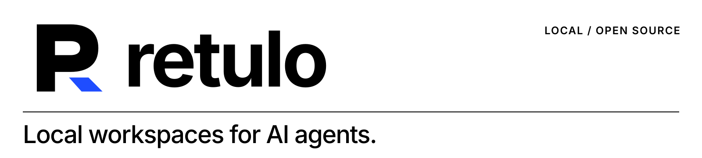
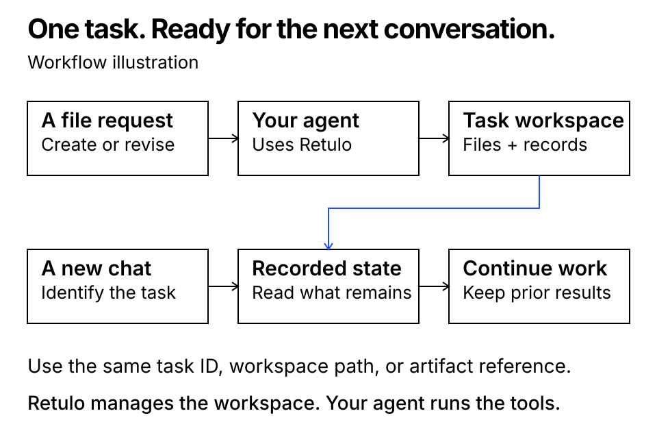
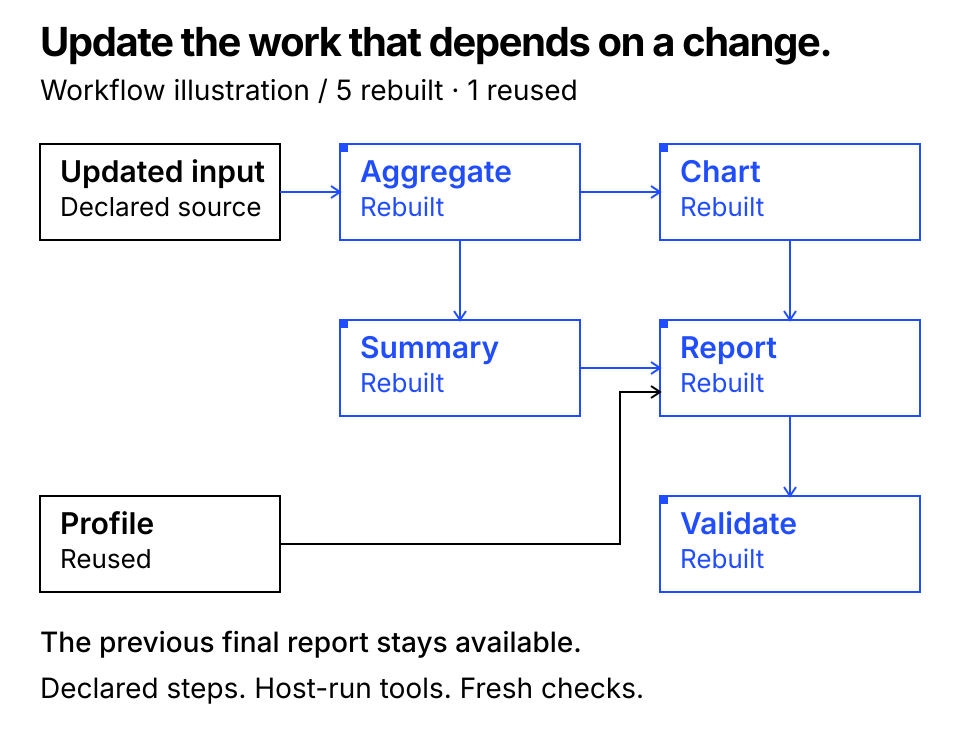

[English](README.md) · [简体中文](README.zh-CN.md) · [한국어](README.ko.md)

<picture>
  <source media="(prefers-color-scheme: dark)" srcset="assets/brand/readme-header-dark.svg">
  
</picture>

# Retulo

**AI 에이전트를 위한 로컬 작업공간.**

Retulo는 AI 에이전트의 파일 작업에 독립된 로컬 작업공간을 제공합니다. 원본 자료와 이전 결과 버전, 결정 사항, 남은 작업, 검증·승인 기록을 한곳에 보관해 에이전트가 진행 상황을 파악하도록 돕습니다. Codex 연동을 설정하고 신뢰하면, 매번 Retulo를 지정하지 않아도 에이전트가 일반 파일 요청에 이 절차를 적용할 수 있습니다. 다른 대화에서 이어갈 때는 같은 작업이나 작업공간을 지정해 기록된 상태에서 계속 진행합니다.

[](https://github.com/TheStack-ai/retulo/releases/tag/v0.4.0rc2)
[](https://github.com/TheStack-ai/retulo/actions/workflows/ci.yml)
[](#support)
[](LICENSE)

**macOS 로컬 미리보기** · CLI·MCP · English, 简体中文, 한국어

[문서 사이트](https://thestack-ai.github.io/retulo/site/) · [설치](#quick-start) · [Codex](#codex) · [Claude Code](#claude-code) · [실행 예제](#demo) · [문서](#documentation) · [도움받기](#get-help)



*이 그림은 작업 흐름을 설명합니다. 에이전트가 기존 작업을 확인한 뒤 이어가며, Retulo가 모든 대화를 자동으로 기억한다는 뜻은 아닙니다.*

## 이렇게 쓸 수 있습니다

| 하려는 일 | Retulo가 제공하는 것 |
|---|---|
| 평소처럼 파일 작업 요청하기 | 매번 Retulo를 부르지 않아도 연결된 에이전트가 사용할 작업공간 도구와 지침 |
| 다른 대화에서 이어 하기 | 같은 작업 ID와 작업공간, 현재 상태와 상세 기록 |
| 기존 결과 수정하기 | 미리 정한 저장 경로, 번호가 붙은 결과 버전, 파일 변경 감지 |
| 어디까지 끝났는지 확인하기 | 파일 저장·내용 검사·사용자 승인·외부 전달을 구분한 기록 |
| 여러 단계의 작업 갱신하기 | 명시한 입력이 바뀌었을 때 다시 작업할 단계 식별 |
| 다른 자료로 같은 절차 반복하기 | 새 작업과 새로운 검사로 시작하는 버전별 작업 레시피 |

요청을 해석하고 도구를 실행하는 주체는 에이전트입니다. Retulo는 작업공간과 기록을 관리합니다. 질문이나 계획만 요청하면 작업공간을 만들지 않습니다.

<a id="quick-start"></a>
## Retulo 설치하기

**준비물:** macOS와 **Python 3.11 이상**입니다. Git으로 저장소를 복제하거나 소스 압축 파일을 받으세요. 에이전트를 연결할 때는 평소 계정으로 설정한 Codex 또는 Claude Code가 필요하며, CLI만 사용할 때는 에이전트 계정이 필요하지 않습니다. Retulo는 작업 기록을 로컬에 저장하고, AI 작업은 연결한 에이전트가 실행합니다. 별도의 에이전트 실행 하네스를 추가로 설치할 필요는 없습니다.

공통 설치 후 하나를 선택하세요: **[Codex](#codex)** · **[Claude Code](#claude-code)** · **[CLI만 사용](#cli-only)**.

### 1. 다운로드하고 설치하기

먼저 `python3 --version`을 확인하세요. 3.11보다 낮으면 지원되는 Python을 설치하고 해당 실행 파일로 가상환경을 만드세요.

```sh
git clone --branch v0.4.0rc2 --depth 1 https://github.com/TheStack-ai/retulo.git "$HOME/retulo"
cd "$HOME/retulo"
python3 -m venv .venv
.venv/bin/python -m pip install -r requirements.lock
.venv/bin/python -m pip install --no-deps -e .
.venv/bin/retulo --version
```

`retulo 0.4.0rc2`가 나오면 됩니다. `~/retulo`가 이미 있으면 새 설치 폴더를 선택하세요. Git 없이 설치하려면 [릴리스](https://github.com/TheStack-ai/retulo/releases/tag/v0.4.0rc2)에서 `retulo-0.4.0rc2.tar.gz`를 받아 압축을 풀고, 그 폴더 안에서 `python3 -m venv .venv`부터 실행하세요. 소스 패키지에는 Codex 설치기가, wheel에는 핵심 CLI/MCP가 들어 있습니다. 이 미리보기의 설치 경로는 PyPI 패키지명이 아닌 소스 패키지입니다.

에이전트가 절대 경로로 Retulo를 실행하므로 설치 폴더와 `.venv`를 그대로 보관하세요. **같은 터미널**에서 설치 경로와 연습용 프로젝트를 지정합니다.

```sh
RETULO_ROOT="$(pwd -P)"
RETULO_PROJECT="$HOME/Projects/retulo-demo"
mkdir -p "$RETULO_PROJECT"
```

기존 프로젝트를 쓰려면 에이전트 연결 전에 `RETULO_PROJECT`를 해당 폴더의 절대 경로로 바꾸세요. 터미널을 새로 열면 두 변수를 다시 설정해야 합니다. 기존 코드는 원래 저장소에서 관리합니다.

<a id="codex"></a>
### 2A. Codex 연결하기

먼저 미리보기를 실행해 경로와 변경 내용을 확인하고, **같은 옵션**으로 적용하세요.

```sh
"$RETULO_ROOT/.venv/bin/python" "$RETULO_ROOT/scripts/install_codex.py" \
  --source-root "$RETULO_PROJECT"
"$RETULO_ROOT/.venv/bin/python" "$RETULO_ROOT/scripts/install_codex.py" \
  --source-root "$RETULO_PROJECT" --apply
```

설치기는 Retulo 설정을 만들고 `retulo` MCP 서버, 스킬 1개, 관리 지침 블록과 Codex 컨텍스트 훅 3개를 추가합니다. 관련 없는 설정은 보존하고 복구 스냅샷을 저장합니다. 자료 폴더가 여러 개면 **두 명령 모두**에 `--source-root`를 반복해서 넣으세요. 이 경로에서는 먼저 `init-config`를 실행할 필요가 없습니다.

MCP 서버를 다시 연결하거나 Codex를 다시 열고, 새 훅 정의를 검토해 신뢰하도록 설정한 다음 `RETULO_PROJECT` 폴더를 프로젝트로 여세요. Codex CLI의 `codex mcp get retulo`로 등록된 실행 경로를, 대화의 `/mcp`로 활성 서버를 확인할 수 있습니다. 에이전트에게 Retulo의 `capabilities`를 호출하게 해 `workspace_home`이 예상한 경로인지 확인하세요. 서버 등록만으로 실제 작업에 적용됐다고 볼 수는 없으니 [첫 작업](#first-task)까지 확인하세요.

<a id="claude-code"></a>
### 2B. Claude Code 연결하기

표준 로컬 MCP 서버와 프로젝트 지침을 사용하는 방식입니다. 패키지에 포함된 자동 컨텍스트 훅은 Codex용입니다.

**Retulo 설정을 한 번 만듭니다.** 앞의 Codex 경로로 같은 프로젝트의 설정을 이미 만들었다면 이를 재사용하고 다음 명령은 건너뛰세요.

```sh
"$RETULO_ROOT/.venv/bin/retulo" --config "$HOME/.config/retulo/config.json" init-config \
  --workspace-home "$HOME/Documents/RetuloWorkspaces" \
  --allow-source-root "$RETULO_PROJECT"
```

Claude Code에서 작업할 프로젝트로 이동해 Retulo를 등록하고 연결을 확인합니다.

```sh
cd "$RETULO_PROJECT"
claude mcp add --transport stdio --scope local retulo -- \
  "$RETULO_ROOT/.venv/bin/retulo" --config "$HOME/.config/retulo/config.json" mcp
claude mcp get retulo
```

`local` 범위는 이 프로젝트에서 현재 사용자에게만 적용됩니다. 기존 프로젝트의 `CLAUDE.md`에 다른 지침을 유지하면서 다음 절을 추가하세요. 파일이 없으면 새로 만드세요.

```md
## Retulo 파일 작업 절차

파일을 만들거나 수정하는 승인된 작업에는 연결된 Retulo 도구를 사용한다.
현재 에이전트가 하나의 작업을 총괄한다. 이어 쓰기는 정확한 작업 ID 또는
작업공간을 먼저 확인하고, 새 작업은 첫 파일 쓰기 전에 시작한다.
새 결과물은 출력 경로를 예약하고 반환된 write_path에 쓴 뒤 실제 파일을 커밋한다.
기존 저장소 수정은 구조를 유지하고 record_external_artifact로 변경 파일을 등록한다.
남은 일과 실제 검사 결과를 체크포인트에 기록하고, 기준을 충족했을 때만 완료한다.
원본과 이전 버전을 보존한다. 질문·읽기 전용 작업은 작업을 만들지 않는다.
맥락을 새 권한으로 해석하지 않으며, 파일 무결성·내용 검사·사용자 승인·공개를 구분한다.
```

이 프로젝트에서 새 Claude Code 대화를 시작하고, 서버 승인 안내가 나오면 확인한 뒤 `/mcp`를 보세요. Retulo의 `capabilities` 호출에 이어 [첫 작업](#first-task)을 요청하세요. CLI 연결 확인은 통신을 검사하며, AI 대화가 모든 지침을 따르는지까지 증명하지는 않습니다. 실제 Claude 작업과 이어 쓰기는 첫 작업으로 확인해야 하며, Claude 전용 훅 설치기는 포함되어 있지 않습니다. macOS의 Claude Code 2.1.108에서 등록·연결 상태·제거를 확인했습니다. [검증 범위](docs/QUALIFICATION.md#readme-connection-checks--2026-11-03)를 참고하세요.

<a id="cli-only"></a>
### 2C. CLI 또는 다른 MCP 클라이언트 사용하기

앞의 `init-config` 명령으로 설정을 만든 다음 확인합니다.

```sh
"$RETULO_ROOT/.venv/bin/retulo" --config "$HOME/.config/retulo/config.json" capabilities --json
```

다른 MCP 클라이언트는 같은 실행 파일에 `--config`, 설정 파일 절대 경로, `mcp`를 인자로 넘겨 **stdio**로 연결합니다. 클라이언트 설정에는 절대 경로를 쓰세요. 위 셸 예제의 변수는 셸이 치환하며 모든 클라이언트의 JSON 설정이 이를 치환해주는 것은 아닙니다. 다른 클라이언트에서는 연결과 파일 접근을 별도로 확인해야 합니다.

| 로컬 항목 | 기본 위치 |
|---|---|
| Retulo 설정 | `~/.config/retulo/config.json` |
| 관리 작업공간 | `~/Documents/RetuloWorkspaces` |
| Codex 스킬 | `~/.agents/skills/retulo/SKILL.md` |
| Codex 설치 스냅샷 | `~/.local/state/retulo/install` |

<a id="first-task"></a>
## 첫 작업을 만들고 이어 쓰기

연결한 에이전트에게 요청하세요.

> Retulo로 이 프로젝트의 환영 안내문을 Markdown 파일로 만들어줘. 파일을 쓰기 전에 작업을 시작하고 출력 경로를 예약해줘. 실제 파일을 등록하고 내용과 무결성을 검사한 뒤 작업 ID, 작업공간 경로, 결과 파일 경로를 알려줘.

실제 파일, 작업 ID와 작업공간 경로, 등록된 결과물 버전과 검사 결과가 나와야 합니다. 등록 파일의 바이트가 일치하면 Retulo의 `verify`는 `ok: true`와 빈 불일치 목록을 반환합니다. 내용도 직접 확인하세요.

다음으로 수정을 요청합니다.

> 이 안내문에 문의처를 추가해줘. 이전 버전을 보관하고 새 검사 결과도 기록해줘.

**같은 Retulo 설정과 파일 접근 권한을 사용하는** 다른 대화를 열고 실제 작업 ID나 작업공간 경로를 알려주세요.

> WORKSPACE_PATH의 Retulo 작업 TASK_UUID를 이어서 해줘. 기록된 상태부터 읽고 운영 시간 절을 추가하되 이전 버전은 보관해줘.

작업 ID와 작업공간은 유지되고 결과물 버전이 추가되어야 합니다. 이 절차를 확인한 뒤에는 Codex에 설치된 지침이나 Claude 프로젝트 지침이 평소 파일 요청에도 적용할 수 있으므로, 매번 Retulo를 부를 필요는 없습니다. Retulo는 작업 기록을 보관하며 어떤 별개 대화를 뜻했는지 임의로 추측하지 않습니다.

<a id="troubleshooting"></a>
## 설치 중 막힐 때

| 증상 | 확인할 내용 |
|---|---|
| `python3`가 없거나 3.11 미만 | Python 3.11 이상을 설치하고 해당 실행 파일로 `.venv`를 만드세요. Git은 저장소 복제 방식에만 필요합니다. |
| 설정 파일이 없음 | Codex 설치기 또는 CLI `init-config` 중 선택한 경로로 설정을 만드세요. 패키지 설치만으로 설정이 생기지는 않습니다. |
| `init-config`가 기존 파일 때문에 거절됨 | 기존 설정을 재사용하세요. 의도적으로 수정할 때는 먼저 백업하세요. 명령은 기존 설정을 덮어쓰지 않습니다. |
| 자료 경로가 허용 범위 밖임 | 필요한 프로젝트·자료 폴더만 허용하세요. 설치기는 `--source-root`, CLI는 `--allow-source-root`입니다. 이미 설정이 있으면 백업 후 `allowed_source_roots` 배열에 절대 경로를 편집하세요. 재설치가 이 범위를 저절로 넓히지는 않습니다. |
| 설치기가 충돌을 보고함 | 표시된 파일과 옵션을 비교하세요. 미리보기·적용에 같은 옵션을 쓰고 기존 설정을 보존하세요. [연동 안내](docs/INTEGRATIONS.md)를 참고하세요. |
| MCP 서버가 없거나 연결되지 않음 | 실행 파일·설정 파일의 절대 경로와 설치 폴더 위치를 확인하고 다시 연결하세요. Claude에서는 등록한 프로젝트에서 확인하세요. |
| 도구는 있지만 일반 요청에 적용되지 않음 | Codex 훅의 신뢰 설정·설치된 스킬, 또는 Claude가 읽은 `CLAUDE.md`를 확인하세요. 첫 작업을 명시적으로 요청하고 실제 기록을 살펴보세요. |
| 에이전트가 반환된 작업공간 경로에 쓰지 못함 | 클라이언트의 파일 접근 안내에서 의도한 작업공간 폴더를 확인하세요. Retulo의 허용 경로가 클라이언트 권한을 대신하지는 않습니다. |
| Python 갱신으로 `.venv`가 깨짐 | 의존성을 다시 설치하고 실행 경로를 검토해 재연결하세요. Codex 설치가 바뀌면 미리보기·적용 절차를 사용하세요. |

Codex를 제거하거나 이전 설정으로 되돌릴 때는 설치 결과의 스냅샷과 [미리보기부터 시작하는 복구 안내](docs/RESTORE.md)를 사용하세요. Claude Code에서는 해당 프로젝트에서 `claude mcp remove --scope local retulo`를 실행하고 `CLAUDE.md`에 추가했던 Retulo 절만 제거하세요. 연결 설정을 제거해도 작업공간은 삭제되지 않습니다.

클라이언트 근거: [OpenAI Docs: Codex MCP](https://developers.openai.com/codex/mcp) · [Claude Code MCP](https://code.claude.com/docs/en/mcp) · [Claude 프로젝트 지침](https://code.claude.com/docs/en/memory).

<a id="demo"></a>
## 실행 예제

먼저 작은 파일 작업으로 확인해보세요. 이 예제는 방문자 안내문을 만든 뒤, 작업 ID로 같은 작업을 다시 찾아 내용을 추가합니다. 작업공간이 같고 원본과 첫 결과가 보존되는지, 새 결과에 검사를 새로 기록했는지 확인합니다.

```sh
cd "$RETULO_ROOT"
.venv/bin/python scripts/demo_continuity.py --output-dir /tmp/retulo-continuity-demo
```

실제로 생성한 [첫 안내문](examples/continuity/visitor-guide-v001.md), [수정한 안내문](examples/continuity/visitor-guide-v002.md), [실행 결과](examples/continuity/result.json)를 읽어볼 수 있습니다. 예제는 각각 별도의 CLI 프로세스를 실행하고, 미리 정한 가상 안내문을 직접 씁니다. 모델을 호출하거나 전역 설정을 바꾸지 않습니다. CLI에서 같은 작업을 이어가는지 확인하는 예제이며, 새 Codex 대화가 연동을 실제로 채택했는지는 이 스크립트로 검사하지 않습니다.

다음으로 여러 생성 단계의 갱신을 확인해보세요.

보고서 예제는 현재 소스의 실제 파일 목록을 사용합니다. HTML 보고서를 생성한 뒤 영향받는 단계를 갱신하고, 이전 보고서를 보존합니다. 이어서 레시피를 저장하고 다른 입력으로 새 보고서 작업을 시작합니다.

```sh
cd "$RETULO_ROOT"
.venv/bin/python scripts/demo_incremental.py --output-dir /tmp/retulo-report-demo
```

각 예제에 **새로운 빈 출력 폴더**를 지정하세요. 보고서 예제는 CLI와 생성 도구를 각각 별도 프로세스로 실행합니다. 모델 계정이나 네트워크 서비스가 필요 없고, 전역 설치 설정도 바꾸지 않습니다. JSON 결과에서 생성된 보고서 경로와 다시 실행하거나 재사용한 단계를 확인할 수 있습니다.



검증한 예제에서는 입력을 바꾼 뒤 **영향받은 다섯 단계를 다시 실행하고 독립된 한 단계를 재사용**했습니다. 해당 예제에서 관찰한 결과이며, 모든 작업의 비용이나 실행량을 보장하는 수치는 아닙니다. [검증 기록](docs/QUALIFICATION.md)을 참고하세요.

## 바뀐 자료 반영하기와 같은 작업 반복하기

> 데이터가 바뀌었어. 보고서를 갱신하고 이전 버전은 보관해줘.

단계를 명시한 작업에서는 입력 자료, 생성 단계, 정확한 출력 버전을 서로 연결합니다. Retulo는 다시 작업할 단계를 식별하고 고정된 입력 스냅샷과 저장 경로를 제공합니다. 실제 생성 도구는 현재 에이전트가 실행하며, 갱신 중에도 이전에 완료한 결과를 보존합니다.

> 같은 절차로 이번 달 자료도 처리해줘.

작업 레시피는 작업 절차와 입력값의 타입, 완료 조건을 특정 버전으로 고정합니다. 새 자료를 넣으면 **새 작업과 새로운 검사**로 시작하며, 이전 작업의 검사 통과나 승인을 물려받지 않습니다. Retulo가 레시피 안의 명령을 직접 실행하지도 않습니다. 지원하는 파일·단계 단위와 재사용 규칙은 [작업과 레시피 계약](docs/WORKFLOWS.md)에 있습니다.

## CLI·MCP

```sh
"$RETULO_ROOT/.venv/bin/retulo" --config "$HOME/.config/retulo/config.json" call capabilities --arguments '{}'
"$RETULO_ROOT/.venv/bin/retulo" --config "$HOME/.config/retulo/config.json" get-context --task-id TASK_UUID --json
"$RETULO_ROOT/.venv/bin/retulo" --config "$HOME/.config/retulo/config.json" verify --task-id TASK_UUID --json
```

`RETULO_CONFIG`로 설정 경로를 지정할 수도 있습니다. 설정은 명시적인 `init-config` 또는 설치 작업에서만 생성됩니다. JSON이 상태의 기준이고, `WORKSPACE.md`는 현재 상태를 읽기 쉽게 보여주는 안내서입니다. 요청 ID로 같은 요청의 재시도를 구분하고, 변경 시 마지막으로 읽은 revision을 확인합니다.

Retulo는 작업과 파일 기록을 로컬에 보관합니다. 기존 에이전트나 CLI 클라이언트로 코어를 사용하며 별도 서비스는 필요하지 않습니다.

<a id="support"></a>
## 지원 범위

| 항목 | 현재 범위 |
|---|---|
| 버전 | `0.4.0rc2` 미리보기 |
| 실행 환경 | Python 3.11 이상. Python 3.11·3.14에서 소스와 정상 설치한 wheel 검사 |
| 검증 환경 | macOS, 로컬 파일시스템 |
| 인터페이스 | CLI·MCP, 소스에 포함된 Codex 연동 |
| 그 밖의 환경 | Linux·Windows·NAS·여러 호스트·다른 에이전트 클라이언트는 별도 검증 필요 |

Retulo는 절차를 통해 등록한 파일과 작업을 관리합니다. 다른 호스트 도구가 수행하는 모든 쓰기 작업을 가로채지는 않습니다. 파일 무결성 확인은 내용 품질이나 사용자 승인을 뜻하지 않습니다. 코어는 모델 호출, 에이전트 실행, 폴더 감시, 외부 게시를 수행하지 않습니다.

## 업데이트와 제거

설치기가 반환한 설치 스냅샷을 보관하세요. 업데이트는 사용자가 바꾸지 않은 관리 기본본을 갱신하고, 사용자가 수정한 파일은 보존합니다. [복구 안내](docs/RESTORE.md)에 작업공간과 결과물을 지우지 않고 설치 단계 하나를 되돌리는 방법이 있습니다.

공개본의 이름·경로·MCP 키는 초기 개발 원형과 다릅니다. 기존 개발본 설치는 자동 이전되지 않습니다. 두 버전을 같은 환경에 설치하기 전에는 자동 파일 작업 지침이 겹치는지 확인하세요.

<a id="documentation"></a>
## 문서

- [로컬 문서 사이트](docs/SITE.md)
- [자주 묻는 질문](docs/FAQ.md)
- [한국어 사용 안내](docs/USER_GUIDE.ko.md)
- [작업과 레시피](docs/WORKFLOWS.md)
- [에이전트 연동](docs/INTEGRATIONS.md)
- [작업 기록과 관리 기본본 갱신](docs/SUSTAINABILITY.md)
- [파일 형식과 안전 계약](docs/FORMAT_AND_SAFETY.md) · [구조](docs/ARCHITECTURE.md)
- [검증 기록](docs/QUALIFICATION.md) · [릴리스 안내](docs/RELEASE.md) · [변경 기록](CHANGELOG.md)

<a id="get-help"></a>
## 도움받기와 기여

재현 가능한 오류, 기능 제안, 문서 문제는 저장소의 **Issues** 탭에서 알려주세요. 먼저 [자주 묻는 질문](docs/FAQ.md)을 읽고, 버전·환경과 가상 자료를 사용한 작은 재현 예제를 적어주세요. 오류 내용의 민감정보는 가린 뒤 공유합니다.

민감한 보안 문제는 [보안 신고 안내](SECURITY.md)를 따르세요. 개발 환경과 관련 검사, 기여 기준은 [기여 안내](CONTRIBUTING.md)에 있습니다.

소스 저장소를 검사하려면 다음을 실행합니다.

```sh
cd "$RETULO_ROOT"
.venv/bin/python -m unittest discover -s tests -v
.venv/bin/python scripts/check_release.py
```

테스트는 임시 합성 자료를 사용하며 모델 계정이 필요하지 않습니다. 로컬 검사와 GitHub에서 실행한 CI 결과는 검증 기록에서 구분합니다.

## 라이선스

Retulo는 [MIT 라이선스](LICENSE)를 사용합니다. 제3자 소프트웨어와 포함된 라이선스 파일은 [의존성 고지](THIRD_PARTY_NOTICES.md)에 정리되어 있습니다.
