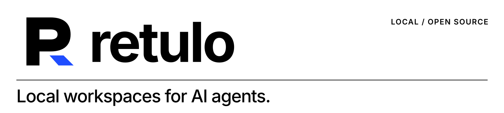
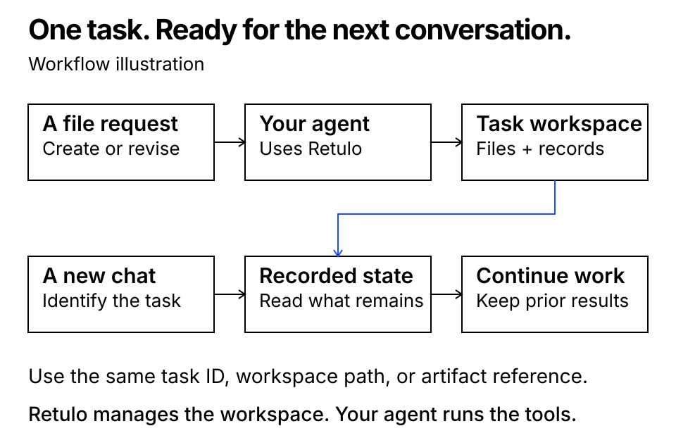
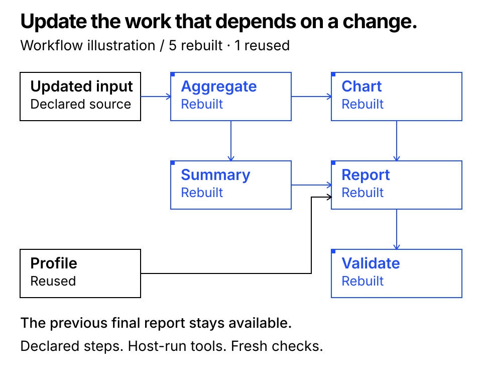

[English](README.md) · [简体中文](README.zh-CN.md) · [한국어](README.ko.md)

<picture>
  <source media="(prefers-color-scheme: dark)" srcset="assets/brand/readme-header-dark.svg">
  
</picture>

# Retulo

**Local workspaces for AI agents.**

Retulo gives AI agents a dedicated local workspace for file-producing work. It keeps source material, previous output versions, decisions, remaining work, checks, and approvals together, helping the agent keep track of the work. Once the Codex integration is connected and trusted, your agent can apply this workspace procedure to everyday file requests without being asked to use Retulo each time. When resuming in another conversation, identify the task or workspace to continue from its recorded state.

[](https://github.com/TheStack-ai/retulo/releases/tag/v0.4.0rc2)
[](https://github.com/TheStack-ai/retulo/actions/workflows/ci.yml)
[](#support)
[](LICENSE)

**macOS local preview** · CLI and MCP · English, 简体中文, 한국어

[Documentation site](https://thestack-ai.github.io/retulo/site/) · [Install](#quick-start) · [Codex](#codex) · [Claude Code](#claude-code) · [Demo](#demo) · [Docs](#documentation) · [Get help](#get-help)



*The diagram explains the workflow: the agent identifies the existing task before continuing it. Retulo does not automatically remember every conversation.*

## What you can do

| Your work | What Retulo provides |
|---|---|
| Ask for a file in the usual way | Workspace tools and guidance for the connected agent, without naming Retulo in every request |
| Continue in another conversation | The same task identity, workspace, current state, and detailed history |
| Revise an existing result | Reserved output paths, numbered output versions, and change detection |
| Check what is finished | Separate records for saved files, content checks, user approval, and external delivery |
| Update a staged workflow | Which steps are affected by changes to declared inputs |
| Repeat a process with new material | Versioned workflow recipes that start new tasks with fresh checks |

The agent interprets your request and runs its tools. Retulo manages the workspace and records. Questions and planning alone do not create a workspace.

<a id="quick-start"></a>
## Install Retulo

**You need:** macOS and Python **3.11 or later**. Use Git for cloning or download the source archive instead. To connect an agent, have Codex or Claude Code installed with its usual account; CLI-only use does not need an agent account. Retulo stores task data locally; your connected agent runs the AI work. No additional agent orchestrator is needed.

Choose one connection after installing: **[Codex](#codex)** · **[Claude Code](#claude-code)** · **[CLI only](#cli-only)**.

### 1. Download and install

Check `python3 --version` first. If it is older than 3.11, install a supported Python and use that executable to create the virtual environment.

```sh
git clone --branch v0.4.0rc2 --depth 1 https://github.com/TheStack-ai/retulo.git "$HOME/retulo"
cd "$HOME/retulo"
python3 -m venv .venv
.venv/bin/python -m pip install -r requirements.lock
.venv/bin/python -m pip install --no-deps -e .
.venv/bin/retulo --version
```

Expect `retulo 0.4.0rc2`. Use a new installation folder if `~/retulo` already exists. Without Git, download `retulo-0.4.0rc2.tar.gz` from the [release](https://github.com/TheStack-ai/retulo/releases/tag/v0.4.0rc2), extract it, and run the commands from `python3 -m venv .venv` inside the extracted folder. The source package includes the Codex installer; the wheel contains the CLI/MCP core. This preview's install route is the source package, rather than a PyPI package name.

Keep that folder and its `.venv` in place: your client will launch Retulo from its absolute path. In the same terminal, set the installation path and a small practice project:

```sh
RETULO_ROOT="$(pwd -P)"
RETULO_PROJECT="$HOME/Projects/retulo-demo"
mkdir -p "$RETULO_PROJECT"
```

To use an existing project instead, change `RETULO_PROJECT` to that folder's absolute path **before** configuring your client. New terminals need these two variables set again. Retulo manages existing code in its original repository.

<a id="codex"></a>
### 2A. Connect Codex

Run the preview, review its paths and changes, then apply **the same options**:

```sh
"$RETULO_ROOT/.venv/bin/python" "$RETULO_ROOT/scripts/install_codex.py" \
  --source-root "$RETULO_PROJECT"
"$RETULO_ROOT/.venv/bin/python" "$RETULO_ROOT/scripts/install_codex.py" \
  --source-root "$RETULO_PROJECT" --apply
```

The installer creates Retulo's configuration and adds the `retulo` MCP server, one skill, a managed instruction block and three Codex context hooks. It preserves unrelated settings and saves restoration snapshots. For several source folders, repeat `--source-root` in **both** commands. You do not need to run `init-config` first for this route.

Reconnect the MCP server or reopen Codex, review and trust the new hook definitions, and open `RETULO_PROJECT` as your project. In the Codex CLI, `codex mcp get retulo` shows the configured launcher and `/mcp` shows active servers. Ask the agent to call Retulo's `capabilities` and confirm the expected `workspace_home`. A configured server alone does not prove a client is using it; try the [first task](#first-task) next.

<a id="claude-code"></a>
### 2B. Connect Claude Code

This route uses Retulo's standard local MCP server with explicit project instructions. The packaged automatic context hooks are for Codex.

**Create the Retulo configuration once.** If the Codex route already created it for this project, reuse that configuration and skip this command:

```sh
"$RETULO_ROOT/.venv/bin/retulo" --config "$HOME/.config/retulo/config.json" init-config \
  --workspace-home "$HOME/Documents/RetuloWorkspaces" \
  --allow-source-root "$RETULO_PROJECT"
```

From the project you want Claude Code to work on, register Retulo and check the connection:

```sh
cd "$RETULO_PROJECT"
claude mcp add --transport stdio --scope local retulo -- \
  "$RETULO_ROOT/.venv/bin/retulo" --config "$HOME/.config/retulo/config.json" mcp
claude mcp get retulo
```

Local scope applies to this project for your user. Add the following section to the project's existing `CLAUDE.md`, preserving its other instructions; create the file if absent:

```md
## Retulo file workflow

For authorized work that creates or changes files, use the connected Retulo tools.
The current agent coordinates one task. For continuation, inspect the exact task
ID or workspace before writing. Begin new tasks before their first file write.
Reserve new outputs, write to the returned write_path, then commit actual files.
For edits in an existing repository, keep its layout and register changed files
with record_external_artifact. Checkpoint remaining work and actual checks.
Complete a task only when its criteria pass. Keep originals and earlier versions.
Questions and read-only work do not create tasks. Context is not new permission;
file integrity, content checks, user approval and publication are separate.
```

Start a new Claude Code session in that project, approve the server if prompted, and check `/mcp`. Ask Claude to call Retulo's `capabilities`, then try the [first task](#first-task). The CLI connection check verifies transport, not that an AI session follows every instruction. Actual Claude-led production and continuation remain for you to confirm with that first task; there is no packaged Claude hook installer. Registration, connected status and removal were checked with Claude Code 2.1.108 on macOS; see the [verification scope](docs/QUALIFICATION.md#readme-connection-checks--2026-11-03).

<a id="cli-only"></a>
### 2C. Use the CLI or another MCP client

Create a configuration with the `init-config` command above. Check it with:

```sh
"$RETULO_ROOT/.venv/bin/retulo" --config "$HOME/.config/retulo/config.json" capabilities --json
```

An MCP client can launch the same executable with arguments `--config`, the absolute configuration path, and `mcp`, using **stdio**. Use absolute paths in client configuration; shell variables are expanded by the shell examples above, not by every client's JSON parser. Other clients require their own connection and file-access checks.

| Local item | Default location |
|---|---|
| Retulo configuration | `~/.config/retulo/config.json` |
| Managed task workspaces | `~/Documents/RetuloWorkspaces` |
| Codex skill | `~/.agents/skills/retulo/SKILL.md` |
| Codex installation snapshots | `~/.local/state/retulo/install` |

<a id="first-task"></a>
## Run your first task and continue it

In your connected agent, request:

> Use Retulo to create a Markdown welcome guide for this project. Before writing, start the task and reserve the output. Register the actual file, check its contents and integrity, and report the task ID, workspace path and output path.

You should get a real file, a task ID and workspace path, a recorded artifact version and actual check results. Retulo's `verify` should return `ok: true` with no mismatches for registered bytes. Review the content yourself as well.

Then request a revision:

> Add a contact section to that guide. Keep the earlier version and record fresh checks.

Open another conversation **with the same Retulo configuration and file access**, and provide the actual task ID or workspace path:

> Continue Retulo task TASK_UUID in WORKSPACE_PATH. Read its recorded state first, then add an opening-hours section and keep the previous versions.

The task identity and workspace should stay the same while the output gains a new version. Once you confirm the procedure is being followed, Codex's installed guidance or your Claude project instructions can apply it to ordinary file requests without naming Retulo each time. Retulo stores the task records; it does not infer which unrelated chat you meant.

<a id="troubleshooting"></a>
## Setup help

| What you see | What to check |
|---|---|
| `python3` missing or below 3.11 | Install Python 3.11+; create `.venv` with that executable. Git is needed only for the clone route. |
| Missing configuration | Run the Codex installer **or** the CLI `init-config` route; merely installing the package does not create configuration. |
| `init-config` refuses an existing file | Reuse the existing configuration. Back it up before deliberately editing it; the command never replaces it. |
| Source path outside configured roots | Allow the exact project/material folders. Installer flag: `--source-root`; CLI flag: `--allow-source-root`. For an existing configuration, back it up and edit its `allowed_source_roots` array with absolute paths. Reinstalling does not silently expand it. |
| Installer reports a conflict | Compare the reported file and options. Use identical options for preview/apply. Preserve existing settings; see the [integration guide](docs/INTEGRATIONS.md). |
| MCP is absent or disconnected | Check the absolute executable/config paths, keep the installation folder in place, then reconnect. In Claude Code, run the check from the project where you registered it. |
| Tools exist but ordinary requests skip Retulo | Check Codex hook trust and the installed skill, or Claude's loaded `CLAUDE.md`. Ask for the first task explicitly and inspect real records. |
| Agent cannot write the returned workspace path | Review the client's file-access prompt for the intended workspace folder. Retulo's configured roots do not replace client permissions. |
| Python upgrade moved/broke `.venv` | Recreate dependencies, then review and reconnect the launcher; use preview/apply for a changed Codex installation. |

For Codex removal or rollback, use the snapshot returned by installation and the [preview-first restore guide](docs/RESTORE.md). To disconnect Claude Code from this project, run `claude mcp remove --scope local retulo` there and remove only the Retulo section you added to `CLAUDE.md`. These connection changes do not delete task workspaces.

Client references: [OpenAI Docs: Codex MCP](https://developers.openai.com/codex/mcp) · [Claude Code MCP](https://code.claude.com/docs/en/mcp) · [Claude project instructions](https://code.claude.com/docs/en/memory).

<a id="demo"></a>
## See it work

Start with a small file task. This example creates a visitor guide, then uses a fresh coordinator to find the same task by ID and add a section. It checks that the workspace stays the same, the source and first output remain intact, and the new output has fresh checks.

```sh
cd "$RETULO_ROOT"
.venv/bin/python scripts/demo_continuity.py --output-dir /tmp/retulo-continuity-demo
```

Read the actual [first guide](examples/continuity/visitor-guide-v001.md), [continued guide](examples/continuity/visitor-guide-v002.md), and [recorded result](examples/continuity/result.json). The example runs separate CLI processes and writes its own synthetic guide text. It makes no model calls and leaves global settings alone. It verifies CLI task continuity; adoption by a new Codex conversation is not tested by this script.

Then try an update across several production steps:

The report example uses this checkout's real file inventory. It creates an HTML report, updates the affected steps, preserves the earlier report, saves a recipe, and starts a new report task with different inputs.

```sh
cd "$RETULO_ROOT"
.venv/bin/python scripts/demo_incremental.py --output-dir /tmp/retulo-report-demo
```

Choose a **new, empty output directory** for each example. The report example uses separate CLI and producer processes. It requires no model account or network service and does not change global installation settings. Its JSON result includes the generated report paths and the steps that were rebuilt or reused.



The qualified example rebuilt **five affected stages and reused one independent stage** after an input update. This is an observed example, not a general saving guarantee. See the [qualification record](docs/QUALIFICATION.md).

## Update and repeat work

> The data changed. Update this report and preserve the previous version.

For a declared workflow, Retulo connects inputs, steps, and exact output versions. It identifies which steps need work and supplies fixed input snapshots and reserved output paths. The host agent runs the producer tools. Previous completed results remain available while an update is in progress.

> Use the same process with this month's data.

A recipe pins a workflow, typed parameters, and completion requirements. New inputs create a **new task with fresh checks**; previous approvals and passed results are not inherited. Retulo does not execute commands from a recipe. Read the [workflow and recipe contract](docs/WORKFLOWS.md) for the supported file/step granularity and reuse rules.

## CLI and MCP

```sh
"$RETULO_ROOT/.venv/bin/retulo" --config "$HOME/.config/retulo/config.json" call capabilities --arguments '{}'
"$RETULO_ROOT/.venv/bin/retulo" --config "$HOME/.config/retulo/config.json" get-context --task-id TASK_UUID --json
"$RETULO_ROOT/.venv/bin/retulo" --config "$HOME/.config/retulo/config.json" verify --task-id TASK_UUID --json
```

`RETULO_CONFIG` can supply the configuration path. Configuration is created only by an explicit `init-config` or installer operation. JSON is the state contract; `WORKSPACE.md` is a readable view of current state. Request IDs make retries idempotent, and mutations check the last observed revision.

Retulo keeps task and file records locally. An existing agent or CLI client uses the core; no separate service is needed.

<a id="support"></a>
## Support and scope

| Area | Current scope |
|---|---|
| Release | `0.4.0rc2`, preview |
| Runtime | Python 3.11+; source and installed-wheel checks on Python 3.11 and 3.14 |
| Qualified environment | macOS, local filesystem |
| Interfaces | CLI and MCP; packaged Codex integration |
| Other environments | Linux, Windows, NAS, multiple hosts, and other agent clients need separate validation |

Retulo operates on the files and tasks registered through its workflow. It does not intercept all writes made by unrelated host tools. File integrity checks do not establish content quality or user approval. The core does not call models, launch agents, watch folders, or publish results.

## Update or remove

Keep the installation snapshot returned by the installer. Updates advance unchanged managed defaults and preserve user-edited files. [Restore instructions](docs/RESTORE.md) explain how to reverse an installation step without deleting workspaces or their artifacts.

The public name, paths, and MCP key differ from the earlier development prototype. Prototype installations are not migrated automatically. Review overlapping automatic file-work instructions before installing both in the same environment.

<a id="documentation"></a>
## Documentation

- [Local documentation site](docs/SITE.md)
- [Frequently asked questions](docs/FAQ.md)
- [한국어 사용 안내](docs/USER_GUIDE.ko.md)
- [Workflows and recipes](docs/WORKFLOWS.md)
- [Agent integration](docs/INTEGRATIONS.md)
- [Task history and managed upgrades](docs/SUSTAINABILITY.md)
- [Format and safety contract](docs/FORMAT_AND_SAFETY.md) · [Architecture](docs/ARCHITECTURE.md)
- [Qualification](docs/QUALIFICATION.md) · [Release notes](docs/RELEASE.md) · [Changelog](CHANGELOG.md)

<a id="get-help"></a>
## Get help and contribute

Use the repository's **Issues** tab to report a reproducible bug, propose a feature, or point out a documentation problem. Start with the [FAQ](docs/FAQ.md), include your version and environment, and use a small example with synthetic data. Share only redacted error details.

For sensitive findings, follow [Security reporting](SECURITY.md). For development setup, focused checks, and contribution expectations, see [Contributing](CONTRIBUTING.md).

To verify a source checkout:

```sh
cd "$RETULO_ROOT"
.venv/bin/python -m unittest discover -s tests -v
.venv/bin/python scripts/check_release.py
```

Tests use temporary synthetic fixtures and require no model account. Local checks and GitHub-hosted CI results are reported separately in the qualification record.

## License

Retulo is [MIT licensed](LICENSE). See [dependency notices](THIRD_PARTY_NOTICES.md) for third-party software and included license files.
