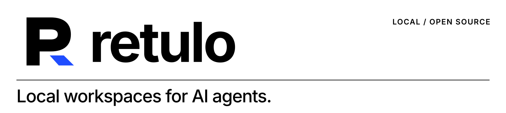
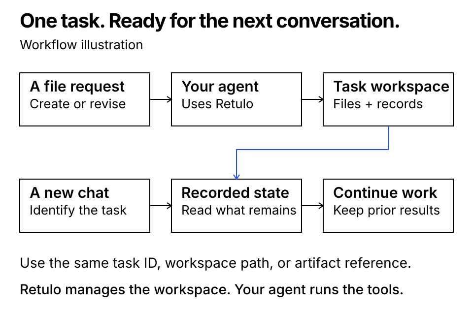
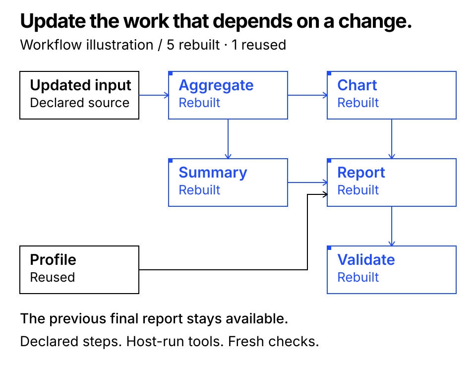

[English](README.md) · [简体中文](README.zh-CN.md) · [한국어](README.ko.md)

<picture>
  <source media="(prefers-color-scheme: dark)" srcset="assets/brand/readme-header-dark.svg">
  
</picture>

# Retulo

**为 AI Agent 提供本地工作区。**

Retulo 为 AI Agent 的文件生成任务提供独立的本地工作区，集中管理原始资料、历史输出版本、关键决策、剩余工作、检查与审批记录，方便 Agent 追踪进度。配置并信任 Codex 或 Claude Code 集成后，Agent 可在处理日常文件请求时应用这一流程，无需每次指定使用 Retulo。切换到新会话时，指定同一任务或工作区，即可根据已记录的状态继续推进。

[](https://github.com/TheStack-ai/retulo/releases/tag/v0.6.0rc1)
[](https://github.com/TheStack-ai/retulo/actions/workflows/ci.yml)
[](#support)
[](LICENSE)

**macOS 本地预览版** · CLI 与 MCP · English、简体中文、한국어

[文档站点](https://thestack-ai.github.io/retulo/site/) · [安装](#quick-start) · [Codex](#codex) · [Claude Code](#claude-code) · [运行示例](#demo) · [文档](#documentation) · [获取帮助](#get-help)



*这张图说明工作流程：Agent 先识别已有任务，再继续处理。它不代表 Retulo 会自动记住所有会话。*

## 可以用它做什么

| 你的工作 | Retulo 提供的支持 |
|---|---|
| 像平常一样提出文件请求 | 为已连接的 Agent 提供工作区工具与指引，无需每次点名调用 Retulo |
| 换一个会话继续处理 | 保留同一任务的标识、工作区、当前状态与详细历史 |
| 修改已有结果 | 预留输出路径、保留带编号的输出版本，并检测文件变更 |
| 确认工作进度 | 分开记录文件保存、内容检查、用户批准与对外交付状态 |
| 更新分阶段工作流 | 依据已声明的输入变化，识别受影响并需重新执行的步骤 |
| 用新资料重复一套流程 | 通过带版本的工作流模板创建新任务，并重新进行检查 |
| 并行处理代码任务 | 显式连接 Git worktree、保存所选文件快照，并在检查后进行 fast-forward 整合 |

Agent 负责理解请求并调用工具，Retulo 负责管理工作区与记录。单纯提问或制定计划不会创建工作区。

<a id="quick-start"></a>
## 安装 Retulo

在 **macOS 或 Linux** 终端中运行：

```sh
curl -fsSL https://thestack-ai.github.io/retulo/install.sh | sh
retulo --version
```

应显示 `retulo 0.6.0rc1`。安装程序下载发布版 wheel，使用发布资产中的 `SHA256SUMS` 验证后，将 Retulo 安装到持久的 uv 工具环境。它会使用已有的 uv，或安装专用副本，并在需要时下载合适的 Python。无需 Git、源码目录或自行维护的虚拟环境。本预览版通过 [GitHub Releases](https://github.com/TheStack-ai/retulo/releases/tag/v0.6.0rc1) 分发，不通过 PyPI 或 npm。

如果提示命令目录不在 `PATH` 中，请运行安装程序显示的命令。默认位置使用：

```sh
export PATH="$HOME/.local/bin:$PATH"
```

安装程序不会修改 shell 配置文件。已测试的本地环境为 macOS；Linux 安装将由 CI 进行验证。脚本审阅、使用已有 uv、定制路径和开发用源码安装见[安装指南](docs/INSTALLATION.md)。

连接 Agent 前，请按通常方式安装并登录 **Codex 或 Claude Code**。Retulo 不安装这两个客户端，也不提供模型账户。选择下面一种连接方式，并将 `/absolute/path/to/project` 换成**已有项目目录的绝对路径**。已有代码仍在原仓库中管理。

<a id="codex"></a>
### 连接 Codex

先预览变更，再使用相同选项应用：

```sh
retulo setup codex --project /absolute/path/to/project
retulo setup codex --project /absolute/path/to/project --apply
retulo doctor codex --project /absolute/path/to/project --connect
```

设置命令创建或更新 Retulo 配置，将所选项目加入源目录允许列表，并通过用户级 Codex MCP 设置连接软件包中的运行环境。它还安装一个 skill、受管理的 `AGENTS.md` 区块和上下文钩子。无关设置会保留，并生成恢复快照。对每个需要允许的项目分别运行设置命令。

重启 Codex，在该项目中开始新会话，并按客户端提示审阅和信任安装的钩子。在 Codex CLI 中用 `codex mcp get retulo` 查看启动配置，在会话中用 `/mcp` 查看活动服务。让 Agent 调用 Retulo 的 `capabilities` 并确认 `workspace_home`，然后尝试[第一个任务](#first-task)。

<a id="claude-code"></a>
### 连接 Claude Code

使用**本地 Claude Code 客户端**和已有项目：

```sh
retulo setup claude --project /absolute/path/to/project
retulo setup claude --project /absolute/path/to/project --apply
retulo doctor claude --project /absolute/path/to/project --connect
```

设置命令管理该项目 `.mcp.json` 中的 `retulo` 条目和 `CLAUDE.md` 中的 Retulo 指令区块，保留无关条目与指令，并保存恢复快照。它也会创建或更新共享 Retulo 配置并允许所选项目。无需手动粘贴 MCP JSON 或项目指令。软件包中的上下文钩子适用于 Codex。

在该项目中启动 Claude Code，信任项目，并在提示时批准 MCP 服务，然后检查 `/mcp`。让 Claude 调用 Retulo 的 `capabilities`，再尝试[第一个任务](#first-task)。此方式连接 Claude Code，不是 claude.ai 网站。

两种客户端均可用 `doctor` 检查本地设置。加上 `--connect` 后，还会启动配置的 Retulo 服务，检查实际 MCP 握手和 capabilities 调用，不调用 AI 或模型。传输正常不代表会话已遵循文件流程，请通过第一个任务确认。

<a id="cli-only"></a>
### 使用 CLI 或其他 MCP 客户端

Agent 设置命令会创建 Retulo 配置。仅用 CLI 时，显式创建一次：

```sh
retulo init-config --workspace-home "$HOME/Documents/RetuloWorkspaces" \
  --allow-source-root /absolute/path/to/project
retulo capabilities --json
```

其他 MCP 客户端可通过 **stdio** 启动 `command -v retulo` 显示的可执行文件绝对路径，参数为 `--config`、配置文件的绝对路径和 `mcp`。其他客户端仍需分别验证连接与文件访问。

| 本地项目 | 默认位置 |
|---|---|
| Retulo 命令 | `~/.local/bin/retulo` |
| Retulo 配置 | `~/.config/retulo/config.json` |
| 受管理的任务工作区 | `~/Documents/RetuloWorkspaces` |
| Codex skill | `~/.agents/skills/retulo/SKILL.md` |
| 安装快照 | `~/.local/state/retulo/install`（Claude 使用其下的 `claude/`） |

已有配置保留原来的工作区位置。setup、doctor 和 disconnect 支持 `--config`、`--workspace-home`、`--snapshot-home`；Codex 还使用 `--codex-home` 和 `--skills-home`。详见[定制路径](docs/INSTALLATION.md#custom-paths)。

<a id="first-task"></a>
## 创建第一个任务并继续处理

在已连接的 Agent 中提出：

> 使用 Retulo 为这个项目生成 Markdown 欢迎指南。写文件前先开始任务并预留输出路径。登记实际文件，检查内容与完整性，并报告任务 ID、工作区路径和输出路径。

应获得实际文件、任务 ID 与工作区路径、已登记的输出版本和检查结果。登记文件的字节一致时，Retulo 的 `verify` 返回 `ok: true` 且没有不匹配项。请同时自行检查内容。

接着请求修订：

> 给指南添加联系方式，保留上一版本并记录新的检查结果。

打开另一个**使用相同 Retulo 配置并具有文件访问权限**的会话，提供实际任务 ID 或工作区路径：

> 继续 WORKSPACE_PATH 中的 Retulo 任务 TASK_UUID。先读取记录状态，再添加开放时间章节，并保留先前版本。

任务 ID 与工作区应保持不变，输出应增加新版本。确认流程有效后，Codex 安装的指令或 Claude 项目指令可用于日常文件请求，无需每次提到 Retulo。Retulo 保存任务记录，不会猜测你指的是哪段无关会话。

<a id="troubleshooting"></a>
## 安装问题排查

| 现象 | 检查方法 |
|---|---|
| `retulo: command not found` | 运行安装程序显示的 `PATH` 命令；默认是 `export PATH="$HOME/.local/bin:$PATH"`。 |
| 下载或校验失败 | 检查网络后重试。不要绕过校验不匹配；报告发布资产名称和错误。 |
| 缺少配置 | 指定项目并用 `--apply` 运行 `retulo setup codex` 或 `retulo setup claude`；仅用 CLI 时运行 `init-config`。 |
| 项目不在允许列表 | 使用该项目的准确路径预览并应用设置；已有允许目录会保留。 |
| 设置报告冲突 | 审阅提示的文件和选项，预览与应用使用相同路径；用户修改不会被静默覆盖。 |
| MCP 缺失或未连接 | 运行 `retulo doctor codex --project /absolute/path/to/project --connect`（或 `claude`），重启客户端并检查服务批准状态。 |
| 有工具却未用于普通请求 | 检查 Codex 钩子信任与 skill，或 Claude 实际加载的 `CLAUDE.md`。明确请求第一个任务并检查实际记录。 |
| Agent 无法写入工作区 | 在客户端的文件访问提示中确认目标目录。Retulo 的允许路径不替代客户端权限。 |
| 项目路径被拒绝 | 选择已存在的具体目录；不允许整个主目录、文件系统根目录或含符号链接的路径。 |

参见[安装与诊断](docs/INSTALLATION.md)、[集成说明](docs/INTEGRATIONS.md)和[先预览的恢复说明](docs/RESTORE.md)。

客户端参考：[OpenAI Docs：Codex MCP](https://developers.openai.com/codex/mcp) · [Claude Code MCP](https://code.claude.com/docs/en/mcp) · [Claude 项目指令](https://code.claude.com/docs/en/memory)。

<a id="demo"></a>
## 运行示例

以下示例需先完成可选的[开发用源码设置](docs/INSTALLATION.md#development-only-source-checkout)，再从源码目录运行。正常安装或连接 Agent 不需要源码目录。

先从一个小型文件任务开始。这个示例创建访客指南，再通过任务 ID 重新找到同一任务并添加章节。它会检查工作区是否相同、原始资料与第一版输出是否完好保留，以及新版是否记录了新的检查。

```sh
.venv/bin/python scripts/demo_continuity.py --output-dir /tmp/retulo-continuity-demo
```

可以直接查看实际生成的[第一版指南](examples/continuity/visitor-guide-v001.md)、[修改后的指南](examples/continuity/visitor-guide-v002.md)与[运行结果](examples/continuity/result.json)。示例启动独立的 CLI 进程，自行写入预设的虚拟指南文本，不调用模型，也不修改全局设置。它验证的是 CLI 任务续接；该脚本不检查新 Codex 会话是否已采用集成。

接下来，试试包含多个生成步骤的更新：

报告示例使用当前源码的真实文件清单，依次生成 HTML 报告、更新受影响的步骤、保留旧报告、保存工作流模板，再用不同输入创建新的报告任务。

```sh
.venv/bin/python scripts/demo_incremental.py --output-dir /tmp/retulo-report-demo
```

请为每个示例选择**新的空输出目录**。报告示例分别启动 CLI 与生成程序进程，无需模型账号或网络服务，也不会改变全局安装设置。其 JSON 结果包含生成报告的路径，以及重新执行或复用的步骤。



已验证的示例在输入更新后，**重新执行五个受影响阶段，复用一个独立阶段**。这是该示例的实际结果，并非对所有任务的节省承诺。详见[验证记录](docs/QUALIFICATION.md)。

## 更新与重复工作

> 数据变了，请更新这份报告，并保留上一版。

对于已声明的工作流，Retulo 关联输入、生成步骤与具体输出版本，明确指出哪些步骤需要重新处理，并提供固定的输入快照与预留输出路径。宿主 Agent 负责调用工具执行重建。在更新期间，之前已完成的输出依然完整保留。

> 请用这套流程处理本月的数据。

工作流模板（Recipes）固定工作流、参数类型与完成要求。新输入会创建**带有全新检查记录的新任务**，不会继承旧任务的批准或通过结论。Retulo 不会执行模板中的命令。支持的文件/步骤粒度与复用规则见[工作流与模板契约](docs/WORKFLOWS.md)。

## CLI 与 MCP

```sh
retulo --config "$HOME/.config/retulo/config.json" call capabilities --arguments '{}'
retulo --config "$HOME/.config/retulo/config.json" get-context --task-id TASK_UUID --json
retulo --config "$HOME/.config/retulo/config.json" verify --task-id TASK_UUID --json
```

也可用 `RETULO_CONFIG` 指定配置路径。只有显式运行 `init-config` 或安装操作才会创建配置。JSON 是状态依据，`WORKSPACE.md` 是当前状态的可读视图。请求 ID 让重试保持幂等，修改操作还会检查上次读取的版本号。

Retulo 将任务与文件记录保存在本地。通过现有 Agent 或 CLI 客户端即可使用核心功能，无需单独运行服务。

<a id="support"></a>
## 支持范围

| 方面 | 当前范围 |
|---|---|
| 版本 | `0.6.0rc1` 预览版 |
| 运行环境 | Python 3.11+；安装程序在需要时获取 Python |
| 已验证环境 | macOS、本地文件系统 |
| 接口 | CLI、MCP，以及软件包内的 Codex 和 Claude Code 设置、诊断与断开连接 |
| 其他环境 | Linux 安装将由 CI 验证；Windows 手动 Python 设置、NAS、多主机及其他客户端需单独验证 |

Retulo 管理通过其流程登记的文件与任务，不会拦截其他宿主工具的所有写入。文件完整性检查并不等于内容质量确认或用户批准。核心不会调用模型、启动 Agent、监视目录或发布结果。

## 更新或断开连接

再次运行安装命令即可安装此发布版。运行环境或集成版本变化后，使用相同的项目和定制路径选项重新预览、应用设置，并重启客户端。

断开连接时先预览，再应用：

```sh
retulo disconnect codex --project /absolute/path/to/project
retulo disconnect codex --project /absolute/path/to/project --apply
```

Claude Code 连接将 `codex` 替换为 `claude`。断开连接会保留任务工作区、产物和核心 Retulo 配置。请保留恢复快照，详见[安装与断开连接](docs/INSTALLATION.md#disconnect-and-update)及[恢复说明](docs/RESTORE.md)。

公开版本的名称、路径与 MCP 键名不同于早期开发原型。原型安装不会自动迁移；在同一环境同时安装两者前，请检查重复的自动文件工作指令。

<a id="documentation"></a>
## 文档

- [安装、连接与诊断](docs/INSTALLATION.md)
- [本地文档站点](docs/SITE.md)
- [常见问题](docs/FAQ.md)
- [한국어 사용 안내](docs/USER_GUIDE.ko.md)
- [工作流与工作流模板](docs/WORKFLOWS.md)
- [Agent 集成](docs/INTEGRATIONS.md)
- [任务历史与受管更新](docs/SUSTAINABILITY.md)
- [文件格式与安全契约](docs/FORMAT_AND_SAFETY.md) · [架构](docs/ARCHITECTURE.md)
- [验证记录](docs/QUALIFICATION.md) · [版本说明](docs/RELEASE.md) · [变更记录](CHANGELOG.md)

<a id="get-help"></a>
## 获取帮助与参与贡献

通过仓库的 **Issues** 页面报告可复现的错误、提出功能建议或指出文档问题。请先阅读[常见问题](docs/FAQ.md)，说明版本与环境，并使用包含虚拟数据的小型示例。错误信息中的敏感内容应先遮盖。

敏感安全问题请遵循[安全报告流程](SECURITY.md)。开发环境、相关检查与贡献要求见[贡献指南](CONTRIBUTING.md)。

在完成可选的[开发设置](docs/INSTALLATION.md#development-only-source-checkout)后，从源码目录检查：

```sh
.venv/bin/python -m unittest discover -s tests -v
.venv/bin/python scripts/check_release.py
```

测试使用临时合成数据，无需模型账号。本地检查与 GitHub 托管 CI 的结果会在验证记录中分别说明。

## 许可证

Retulo 使用 [MIT 许可证](LICENSE)。第三方软件及随附许可文件详见[依赖声明](THIRD_PARTY_NOTICES.md)。

可选的代码工作流需要本地 Git 和明确配置的 worktree 父目录。设置、恢复及支持范围请参阅 [Git 工作区](docs/GIT_WORKSPACES.md)。
